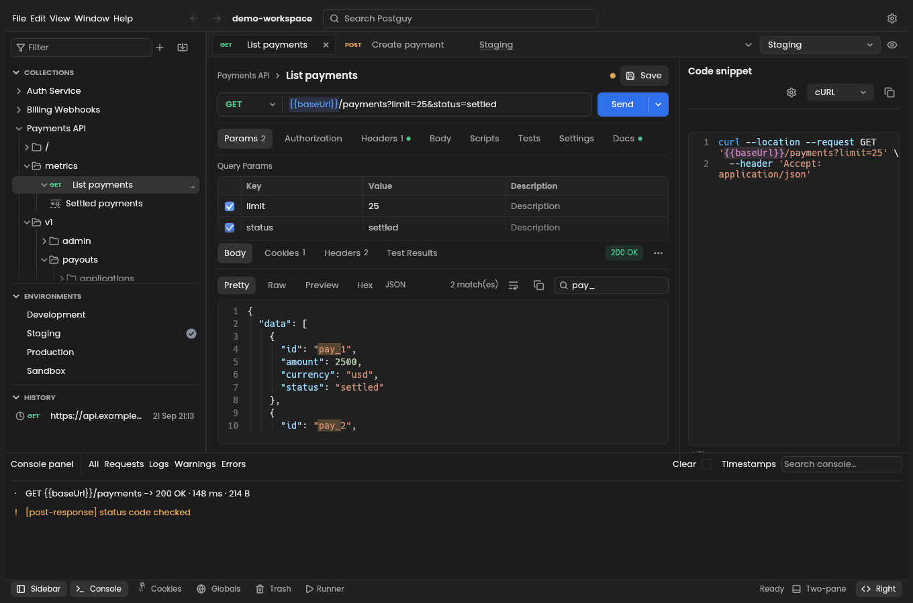

<div align="center">


# Postguy

**A fast, offline API client. HTTP, gRPC and WebSocket in one native app.**

No account. No cloud. No telemetry. Just your requests.

[Download](#install) · [Docs](https://zuramai.github.io/postguy/) · [Releases](https://github.com/zuramai/postguy/releases)

</div>

## Why Postguy

- **Native and light.** Written in Rust. Starts fast, uses little memory.
- **Offline by design.** Your collections stay on your disk. Nothing is sent anywhere you didn't ask for.
- **Bring your work.** Import Postman collections, OpenAPI / Swagger, HAR, cURL and `.proto` files.
- **Scripts and tests.** `pm.test`, `pm.expect` and pre-request scripts, run in a sandbox.
- **Collection runner.** Run whole collections with data files, from the app or the CLI.
- **Scriptable.** Everything works headless through `postguy-cli`.

<br>

<div align="center">
  
</div>

<br>

## Install

**Latest version: [v0.1.1](https://github.com/zuramai/postguy/releases/latest)**

| Platform | Download |
| --- | --- |
| macOS (Apple Silicon + Intel) | [**postguy-0.1.1-macos-universal.dmg**](https://github.com/zuramai/postguy/releases/download/v0.1.1/postguy-0.1.1-macos-universal.dmg) |
| Windows (64-bit) | [**postguy-0.1.1-windows-x64.msi**](https://github.com/zuramai/postguy/releases/download/v0.1.1/postguy-0.1.1-windows-x64.msi) |
| Windows (ARM) | [postguy-0.1.1-windows-arm64.msi](https://github.com/zuramai/postguy/releases/download/v0.1.1/postguy-0.1.1-windows-arm64.msi) |
| Linux (any distro) | [postguy-0.1.1-linux-x86_64.AppImage](https://github.com/zuramai/postguy/releases/download/v0.1.1/postguy-0.1.1-linux-x86_64.AppImage) |
| Debian / Ubuntu | [postguy-0.1.1-linux-x86_64.deb](https://github.com/zuramai/postguy/releases/download/v0.1.1/postguy-0.1.1-linux-x86_64.deb) |
| Fedora / openSUSE | [postguy-0.1.1-linux-x86_64.rpm](https://github.com/zuramai/postguy/releases/download/v0.1.1/postguy-0.1.1-linux-x86_64.rpm) |

Other builds (ARM Linux, Flatpak, portable `.zip`, CLI only) and checksums are on the [releases page](https://github.com/zuramai/postguy/releases/latest).

### macOS

1. Download the [`.dmg`](https://github.com/zuramai/postguy/releases/download/v0.1.1/postguy-0.1.1-macos-universal.dmg) and open it.
2. Drag **Postguy** into **Applications**.
3. Open Postguy. macOS will say it "could not verify" the app, because it isn't signed yet. Click **Done**.
4. Open **System Settings → Privacy & Security**.
5. Scroll down to **Security**. Next to *"Postguy" was blocked*, click **Open Anyway**.
6. Confirm with your password, then click **Open Anyway** again.

You only do this once.

<details>
<summary>Prefer the terminal?</summary>

```sh
xattr -dr com.apple.quarantine /Applications/Postguy.app
open /Applications/Postguy.app
```

</details>

### Windows

1. Download the [`.msi` installer](https://github.com/zuramai/postguy/releases/download/v0.1.1/postguy-0.1.1-windows-x64.msi) and run it.
2. If you see **"Windows protected your PC"**, click **More info**, then **Run anyway**.
3. Finish the installer. Postguy is now in the Start menu.

### Linux

```sh
# AppImage
chmod +x postguy-0.1.1-linux-x86_64.AppImage && ./postguy-0.1.1-linux-x86_64.AppImage

# Debian / Ubuntu
sudo apt install ./postguy-0.1.1-linux-x86_64.deb

# Fedora / openSUSE
sudo dnf install ./postguy-0.1.1-linux-x86_64.rpm
```

## Your data

Postguy saves everything in a plain folder: `~/postguy-workspace` (`%USERPROFILE%\postguy-workspace` on Windows). Use `--workspace DIR` to pick another one.

## Build from source

```sh
cargo run -p postguy          # desktop app
cargo run -p postguy-cli      # headless CLI
cargo xtask ci                # all checks
```

## Contributing

Read [AGENTS.md](AGENTS.md) first, then the [architecture notes](docs/content/4.contributing/3.architecture.md) and the [known gaps](docs/content/4.contributing/4.gaps.md).

## Licence

MIT OR Apache-2.0. Third-party material is listed in [ATTRIBUTION.md](ATTRIBUTION.md) and [NOTICE](NOTICE).
